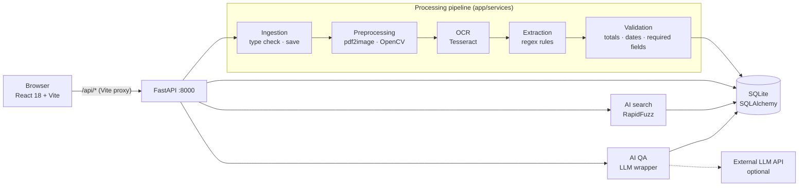

# Invoice OCR & Extraction System

> A full-stack, locally hosted system that turns invoice PDFs and images into structured, validated, searchable data — with fuzzy natural-language search and LLM-powered question answering on top.


*Final-year project, developed in 2026.*

---

## Overview

Processing supplier invoices by hand is slow and error-prone. This system automates it end to end:
a user uploads a PDF or image through a React web app, and a FastAPI backend runs it through a five-stage
pipeline — **preprocessing → OCR → extraction → validation → storage** — producing a structured invoice
record (supplier, number, dates, subtotal, tax, total, currency and line items) stored in SQLite.

Everything runs locally: OCR is done with Tesseract, extraction uses a library of compiled regex rules,
and the data never leaves the machine. An optional AI layer adds fuzzy natural-language search over
suppliers (no external service needed) and free-text question answering about a specific invoice through
a configurable LLM provider.

## Key features

- **Upload & ingestion** — accepts `.pdf`, `.png`, `.jpg`, `.jpeg`; files are stored under UUID names.
- **Image preprocessing** — PDF pages rasterised with `pdf2image`/poppler, then OpenCV grayscale,
  non-local-means denoising and Otsu binarisation.
- **OCR** — Tesseract via `pytesseract` (`--oem 3 --psm 6`, English).
- **Rule-based field extraction** — regex patterns for invoice numbers, invoice/due dates, currencies
  (codes and symbols), subtotal, tax, total, supplier name and line items, with amount normalisation.
- **Business-rule validation** — flags total mismatches (subtotal + tax ≠ total), line items that don't add
  up to the subtotal, implausible or inconsistent dates, and missing required fields.
- **Persistent storage** — SQLAlchemy 2 ORM (`Invoice` + `LineItem`), SQLite by default; each pipeline stage
  updates the record so partial results survive later failures.
- **REST API with Swagger docs** — upload, list, detail and manual correction (`PUT`) of invoices.
- **React SPA** — invoice list, upload page, invoice detail with line-item table and status badges, and an
  AI search page.
- **AI layer** —
  - `GET /api/ai/search` — natural-language supplier search (English or Spanish) using RapidFuzz
    `token_set_ratio`; works with no API key.
  - `POST /api/ai/qa` — answers questions about one invoice, grounded only in its metadata and OCR text
    (truncated to 4,000 characters); returns HTTP 503 if no LLM key is configured.
- **Batch & evaluation tooling** — batch-process a folder to CSV, OCR accuracy (character/word, Levenshtein)
  and per-field extraction precision/recall/F1 scripts.
- **Synthetic dataset generator** — 200 realistic but fictional multi-country invoices for testing.
- **One-command startup** — `start.sh` launches backend and frontend and records their PIDs for clean shutdown.

## Architecture



### API endpoints

| Method | Path | Description |
|---|---|---|
| `GET` | `/health` | Health check |
| `POST` | `/api/invoices/upload` | Upload a file and run the pipeline |
| `GET` | `/api/invoices` | List invoices (summary) |
| `GET` | `/api/invoices/{id}` | Invoice detail with line items |
| `PUT` | `/api/invoices/{id}` | Manually correct extracted fields |
| `GET` | `/api/ai/search?q=...` | Fuzzy natural-language supplier search |
| `POST` | `/api/ai/qa` | Ask a question about one invoice |

Full details in [`invoice_system/docs/api_spec.md`](invoice_system/docs/api_spec.md); design notes in
[`architecture.md`](invoice_system/docs/architecture.md) and [`system_design.md`](invoice_system/docs/system_design.md).

## Tech stack

- **Backend:** Python, FastAPI, Uvicorn, Pydantic v2 / pydantic-settings, SQLAlchemy 2, Alembic
- **OCR & imaging:** Tesseract (`pytesseract`), poppler (`pdf2image`), OpenCV, Pillow, NumPy
- **Search / AI:** RapidFuzz, pluggable LLM client (provider + key set in `.env`)
- **Frontend:** React 18, React Router 6, Vite 5
- **Database:** SQLite (PostgreSQL-compatible via `DATABASE_URL`)
- **Tooling:** Bash startup script, Python CLI scripts for batch processing and evaluation

## Getting started

### Prerequisites

- Python 3.10+, Node.js 18+ and npm
- Tesseract 4+ and poppler on your `PATH`:

```bash
sudo apt install tesseract-ocr poppler-utils
```

### 1. Backend

```bash
cd invoice_system/backend
python -m venv ../venv && source ../venv/bin/activate
pip install -r requirements.txt
cp .env.example .env     # edit if needed
uvicorn app.main:app --reload --host 0.0.0.0 --port 8000
```

### 2. Frontend

```bash
cd invoice_system/frontend
npm install
npm run dev
```

The Vite dev server proxies all `/api/*` requests to the backend automatically.

- **Frontend:** http://localhost:5173
- **Backend API:** http://localhost:8000
- **Swagger UI:** http://localhost:8000/docs

### Quick start (after the first install)

`start.sh` expects the virtual environment at `invoice_system/venv` and the npm packages already installed
(steps 1–2 above). It then starts both services in the background and creates `.env` from `.env.example`
if missing:

```bash
./start.sh        # starts backend + frontend
./start.sh stop   # stops both
```

### Environment variables

Copy `.env.example` to `.env` inside `invoice_system/backend/` and adjust as needed:

| Variable | Default | Description |
|----------|---------|-------------|
| `DATABASE_URL` | `sqlite:///./invoice_system.db` | Database connection string |
| `UPLOAD_DIR` | `./uploads` | Directory for uploaded files |
| `TESSERACT_CMD` | `tesseract` | Path to Tesseract binary |
| `LOG_LEVEL` | `INFO` | Logging verbosity |
| `LLM_PROVIDER` | see `.env.example` | LLM provider used by `/api/ai/qa` (supported values listed in `.env.example`) |
| `LLM_API_KEY` | *(empty)* | API key for the chosen LLM provider |

The default provider's SDK is included in `requirements.txt`; for the alternative provider run
`pip install openai`. `/api/ai/search` works **without** any key (pure fuzzy matching); `/api/ai/qa`
returns HTTP 503 until a valid key is set.

## Usage examples

### Search invoices by natural language

```bash
# All invoices from "Acme Corp" (fuzzy match on supplier_name)
curl "http://localhost:8000/api/ai/search?q=facturas+de+Acme+Corp"

# Works in English too
curl "http://localhost:8000/api/ai/search?q=Acme+Corp+invoices"
```

Response: array of `InvoiceSummary` objects (same shape as `GET /api/invoices`).

### Ask a question about a specific invoice

```bash
curl -X POST http://localhost:8000/api/ai/qa \
  -H "Content-Type: application/json" \
  -d '{"invoice_id": 3, "question": "What is the total amount and which currency?"}'
```

Response:

```json
{
  "invoice_id": 3,
  "question": "What is the total amount and which currency?",
  "answer": "The total amount is 1,920.00 GBP (British Pounds)."
}
```

### Batch processing & evaluation scripts

Run from `invoice_system/backend/` with the venv active:

```bash
# Batch process a folder of invoices into a CSV summary
python scripts/run_pipeline_on_folder.py --input ./sample_invoices --csv ./out/report.csv

# Create the sample/evaluation folders (sample images, OCR outputs, predictions, ground truth)
python scripts/create_sample_data.py

# Evaluate OCR accuracy (OCR .txt outputs vs ground-truth .txt, matched by filename stem)
python scripts/evaluate_ocr_metrics.py \
    --ocr-dir ./ocr_outputs --gt-dir ./ground_truth_text --output ./out/ocr_metrics.tsv

# Evaluate extraction field accuracy (predicted JSON vs ground-truth JSON)
python scripts/evaluate_extraction_metrics.py \
    --pred-dir ./pred_json --gt-dir ./gt_json --tol 0.01 --output ./out/extraction_metrics.tsv
```

### Synthetic invoice data

Generate realistic but fictional invoices for testing (default 200):

```bash
cd invoice_system/backend

# Generate JSON files only (no DB changes)
python scripts/generar_facturas_sinteticas.py

# Generate and insert directly into the database
python scripts/generar_facturas_sinteticas.py --insert-db

# Custom count and output directory
python scripts/generar_facturas_sinteticas.py --count 500 --out-dir /tmp/test_invoices
```

Files are saved to `invoice_system/backend/data/facturas_sinteticas/json/` as
`factura_0001.json … factura_NNNN.json`, each mirroring the full invoice schema:

```json
{
  "filename": "factura_0001.pdf",
  "status": "completed",
  "supplier_name": "Acme Corp Ltd",
  "invoice_number": "INV-2024-0001",
  "invoice_date": "15/03/2024",
  "due_date": "14/04/2024",
  "subtotal": 1600.00,
  "tax_amount": 320.00,
  "total_amount": 1920.00,
  "currency": "GBP",
  "line_items": [...]
}
```

The committed dataset contains 200 invoices from 20 fictional suppliers across GBP, USD, EUR and CHF.
These are JSON records only, so `--insert-db` bypasses OCR and inserts the pre-extracted data directly —
useful for populating a dev/test database. Dataset charts are in
`invoice_system/backend/results_figures/`.

## Project structure

```
.
├── start.sh                          # One-command startup / shutdown
├── sample_invoices/                  # Sample PDF invoices for manual testing
└── invoice_system/
    ├── backend/
    │   ├── app/
    │   │   ├── main.py               # FastAPI entry point
    │   │   ├── config.py             # Settings from .env
    │   │   ├── api/                  # invoices, ai, health routers
    │   │   ├── models/               # SQLAlchemy models (Invoice, LineItem)
    │   │   └── services/             # ingestion, preprocessing, ocr, extraction,
    │   │                             # validation, storage, ai, pipeline.py
    │   ├── scripts/                  # Batch processing, evaluation, data generation
    │   ├── data/facturas_sinteticas/ # 200 synthetic invoice JSON records
    │   ├── ground_truth_text/        # Ground-truth OCR text (evaluation)
    │   ├── gt_json/                  # Ground-truth extraction JSON (evaluation)
    │   ├── sample_invoices/          # Sample PNG invoices
    │   ├── results_figures/          # Dataset and evaluation charts
    │   ├── requirements.txt
    │   └── .env.example
    ├── frontend/
    │   ├── src/
    │   │   ├── pages/                # InvoiceList, InvoiceDetail, UploadPage, AiSearch
    │   │   ├── components/           # LineItemsTable, StatusBadge
    │   │   └── api/                  # Backend API client
    │   └── package.json
    └── docs/                         # Architecture, system design, API spec, usage guide
```

## License

Released under the [MIT License](LICENSE).
